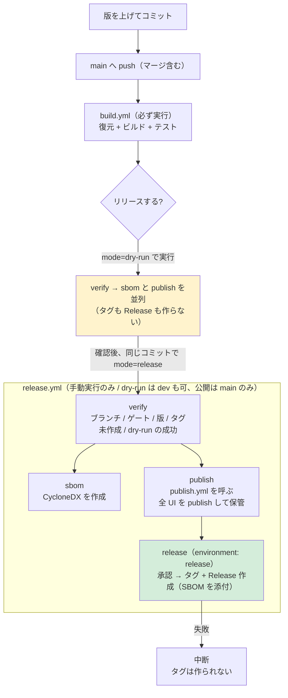

# リリース手順（GitHub Actions）

本ドキュメントは ZenHanConverter の**リリース作業を行う開発者**向けの情報です。
開発環境（ビルド・テスト・CI）は [`CONTRIBUTING.md`](CONTRIBUTING.md)、他のリポジトリへの流用方法は [`REUSING.md`](REUSING.md)、
アプリの利用方法は [`../README.md`](../README.md) を参照してください。

リリースは **手動実行のみ**です。バージョンの**自動インクリメントは行いません**。

## 構成

リリースの設定と処理は、次のファイルが持ちます。**同じ知識を複数箇所に置かない**ことが設計方針です。

| ファイル | 内容 |
| --- | --- |
| [`release-config.json`](release-config.json) | プロダクト名、バージョンファイル、**ビルド対象のソリューション ファイル**、ゲートのワークフロー、**リリースを許可するブランチ**、配布する UI の定義 |
| [`actions/read-config`](actions/read-config/action.yml) | `release-config.json` を読んで各ワークフローへ渡す共通アクション（読み取りの実装はここだけ） |
| [`../Directory.Build.props`](../Directory.Build.props) | リリースバージョン（`<Version>`）。各 `.csproj` では指定しない |
| [`../global.json`](../global.json) | .NET SDK のバージョンと**テスト ランナー**（Microsoft.Testing.Platform）。ワークフローでは指定しない |
| [`workflows/publish.yml`](workflows/publish.yml) | 全 UI の publish とアーティファクト保管の実装（`release.yml` が呼ぶ） |
| [`scripts/version.ps1`](scripts/version.ps1) | バージョンの規則（形式・比較・系列・プレリリース判定・タグの列挙） |

UI の追加・変更は **`release-config.json` の `uis[]` を編集します**（ワークフローとスクリプトの変更は不要です）。
**ビルド・テストの対象は `solutionFile` が持ちます**（ワークフローには書きません）。
**実行できるブランチはモードで変わります**（`dry-run` は `dryRunBranches`、公開は `releaseBranches`。 本リポジトリは dry-run が `["main", "dev"]`、公開が `["main"]`。
`release/` 配下は **`release/<major>.<minor>` の形式**に限定され、入力バージョンの系列と一致させる必要があります）。

```text
<リポジトリルート>/
├── Directory.Build.props     # リリースバージョン（各 .csproj では指定しない）
├── global.json               # .NET SDK のバージョンとテスト ランナー（ワークフローでは指定しない）
├── buildScript/              # UI ごとの publish 手順（release-config.json の uis[].script が指す）
└── .github/
    ├── release-config.json        # リリース設定（リポジトリ固有の設定はこのファイルのみ）
    ├── actions/
    │   └── read-config/
    │       └── action.yml         # release-config.json を読む共通アクション
    ├── dependabot.yml             # GitHub Actions / NuGet の更新 PR
    ├── RELEASE.md                 # 本ドキュメント
    ├── REUSING.md                 # 他のリポジトリへの流用方法
    ├── CONTRIBUTING.md            # 開発環境（ビルド・テスト・CI）
    ├── rulesets/
    │   └── tag-version.json       # Tag ruleset の定義（Settings へインポートする）
    ├── scripts/
    │   ├── version.ps1            # バージョンの規則
    │   ├── set-version.ps1        # バージョンファイルの書き換え（冪等）
    │   ├── verify-release-version.ps1  # リリース可否の検証
    │   └── show-current-versions.ps1   # 現在のバージョン状況の表示
    └── workflows/
        ├── build.yml              # push / PR でビルド・テスト（配布物は作らない）
        ├── publish.yml            # 全 UI の publish と保管（release.yml から呼ばれる）
        └── release.yml            # 手動実行で検証・publish・タグ・Release 作成
```

**注意事項**:

- リリースバージョンは `Directory.Build.props` の `<Version>` に記載し、**各 `.csproj` には記載しないでください**。
  リリース時に `release.yml` がこの 1 行を入力値へ書き換えてコミットします。
- **.NET SDK のバージョンは `global.json` に記載し、ワークフローには記載しないでください**
  （ワークフローは `actions/setup-dotnet` を使わず、ランナー イメージの SDK をそのまま使います。
  `rollForward: latestFeature` のため、イメージの 10.0 SDK で `global.json` の要件を満たします）。
- **テスト ランナー（`test.runner`）も `global.json` が単一所有します。** xunit.v3 4 系は Microsoft.Testing.Platform（MTP）で
  実行するため、`test.runner` に `Microsoft.Testing.Platform` を指定します（未指定だと VSTest ターゲットが使われて失敗します）。
  MTP モードではテスト対象を `--solution` / `--project` で指定してください（位置引数はテスト アプリへの引数として扱われます）。
- 同じ設定を複数箇所に置かないでください（例: UI の定義をワークフローへ直接書く、ソリューション名をワークフローへ書く、バージョンを `.csproj` にも書く、SDK のバージョンをワークフローにも書く）。
  変更時の注意事項は [`REUSING.md`](REUSING.md) にも記載しています。
- **`build.yml` / `publish.yml` / `release.yml` は Windows 固有のターゲットを含むため、ビルド系のジョブは
  `windows-latest` で実行します**（`release.yml` の検証のみ `ubuntu-latest`）。

## 依存関係の更新（Dependabot）

[`dependabot.yml`](dependabot.yml) が、GitHub Actions と NuGet パッケージの更新 Pull Request を作成します。

| 対象 | 間隔 | まとめ方 |
| --- | --- | --- |
| GitHub Actions（`uses:` で参照しているアクション） | 毎週月曜 09:00（Asia/Tokyo） | すべてを 1 つの Pull Request にまとめる |
| NuGet（`src/` と `test/` の各プロジェクト） | 毎月 | minor / patch を 1 つの Pull Request にまとめる |

**注意事項**:

- Dependabot の Pull Request は**読み取り専用トークン・シークレット無し**で実行されます。`build.yml` はシークレットを使わないため、CI はそのまま動作します。
- **NuGet のメジャー更新は作成されません**（テストの書き方が変わるため、手動で判断します）。
- Dependabot は**指定したディレクトリ直下のみを走査します**（再帰しません）。プロジェクトを増やした場合は
  `dependabot.yml` の `directories` にも追加してください。
- Pull Request の内容を確認して `main` へマージします（マージ方式は Squash merge を推奨）。マージ後の `main` への push で `build.yml`（ゲート）が実行されます。
- 破壊的な変更（`actions/upload-artifact` のメジャー更新など）は、CI が失敗した内容を確認して修正します。

## リポジトリの設定（初回のみ）

次はワークフローでは設定できません。リポジトリの **Settings** で有効化します。

### タグの保護（Tag ruleset）

タグ（すべてのタグ）の**更新と削除**を禁止します。定義は
[`rulesets/tag-version.json`](rulesets/tag-version.json) にあります（`gh api -X POST repos/<owner>/<repo>/rulesets --input .github/rulesets/tag-version.json` で適用できます）。

| 項目 | 値 |
| --- | --- |
| Ruleset name | `Protect version tags` |
| Target | **Tags** |
| Enforcement status | **Active** |
| Target tags | `refs/tags/**` |
| Tag protections | **Restrict updates** / **Restrict deletions** / **Block force pushes** |
| Bypass list | **Repository admin**（`RepositoryRole`） |

**設定手順**:

1. **Settings → Rules → Rulesets** を開く
2. **New ruleset** のドロップダウンから **Import a ruleset** を選び、`rulesets/tag-version.json` を指定する
   - インポートできない場合は **New tag ruleset** で上表のとおり手動設定する
3. 内容を確認して **Create** を押下する

**注意事項**:

- **作成は制限していません**。リポジトリ単位の ruleset は **GitHub Actions を Bypass に指定できない**（API が拒否する。実測 2026-10-26）。作成まで止めると `release.yml` がタグを作れなくなるため、**更新と削除だけを保護**し、作成は「**タグを作るのはワークフローだけ**」という規律で守ります。
- **更新・削除は通常は拒否されます**（Bypass は管理者にのみ許されます）。
- ローカルからの `git push origin v0.2.0` や `git push --tags` は行いません（タグは Release 実行時に作成します）。
- 定義を変更した場合は、**同じ JSON の値と実際の ruleset を一致**させてください（ruleset はコードから自動適用されないため、変更時は手動で更新します）。

## ワークフロー

| ワークフロー | 実行契機 | 内容 |
| --- | --- | --- |
| [`workflows/build.yml`](workflows/build.yml) | `main` への push（マージ後）、`main` 向け PR（**必ず実行**）、`dev` への push、手動実行（任意のブランチ） | 復元・ビルド・テスト（**配布物は作らない**） |
| [`workflows/publish.yml`](workflows/publish.yml) | `workflow_call` | 全 UI の publish と保管の単一実装（`version` を受け取るとそのバージョンでビルドする） |
| [`workflows/release.yml`](workflows/release.yml) | **手動実行のみ。 実行ブランチは `mode` に従う**（`dry-run` は `dryRunBranches`、公開は `releaseBranches`）。 `mode` で 2 段階（`dry-run` / `release`） | 検証 → SBOM → 全 UI の publish →（release のみ）**承認** → タグ + GitHub Release 作成 |

`build.yml` の成功実行はリリースの**前提（ゲート）**です。`release.yml` は、リリース対象コミットに対する `build.yml` の成功実行が存在することを確認してから Release を作成します。

**配布物を作る処理は重い（Native AOT を含む）ため、push では実行しません。** 配布物の作成はリリース時に 1 度だけ行います。

**各ジョブには `timeout-minutes` を設定しています**（停止した場合に既定の 6 時間待たないため）。
ビルド・テスト・検証・公開は 30 分、設定の読み取りは 10 分、配布物の作成（`publish.yml` の `publish`）は 60 分です。
なお、再利用ワークフローを呼ぶジョブ（`release.yml` の `publish`）には指定できないため、タイムアウトは呼び先の `publish.yml` が持ちます。



## リリース手順

リリースは **`dry-run` → `release` の 2 段階**で行います。**版はリリース前にコミットしておきます**（自動採番しません）。

1. **版を上げてコミットする**（`Directory.Build.props` の `<Version>`）。`dev` で上げ、`main` へマージする
2. `Actions` → **Build** が成功するまで待つ（`build.yml` の成功はリリースの**前提（ゲート）**です）
3. `Actions` → **Release** → `Run workflow` で、**モード `dry-run`** を選んで実行する
   - 配布物の作成（全 UI の publish）と **SBOM の作成**まで行います（**タグ作成も Release 作成もしません**）
   - `version` は省略できます（省略するとコミット済みの版を使います）
4. 実行サマリーと成果物（アーティファクト）を確認する
5. **同じコミットのまま**、**モード `release`** で実行する
   - **`release` 環境の承認待ち**で止まります（`Actions` → 実行 → **Review deployments** → `release` → **Approve**）
   - 承認後に**タグと GitHub Release** が作られ、配布物と SBOM が添付されます
6. <https://github.com/tomokuni/ZenHanConverter/releases> に配布物が添付されていることを確認する

**注意事項**:

- **実行できるブランチは `release-config.json` の `dryRunBranches`（dry-run）と `releaseBranches`（公開）が決めます**（本リポジトリは dry-run が `["main", "dev"]`、公開が `["main"]`）。 **開発から dry-run までの確認は `dev` で行い、公開は `main` で行います**。
  `verify` ジョブが最初に実行ブランチを検証し、含まれない場合は失敗します。
- **`release` は、同じコミットの `dry-run` が成功していることを要求します**（実行名 `DryRun …` の成功実行を確認します）。
- **版は自動採番しません**。入力 `version` は**確認用**であり、`Directory.Build.props` の `<Version>` と一致しなければ失敗します。
- **タグは配布物の作成と承認が終わった後にだけ作ります**（作成に失敗しても、タグは消費されません）。
- **`release` ジョブは `environment: release` を持ちます**。承認者（Required reviewers）を設定すると、承認するまでタグは作られません。
- **ワークフローはバージョンをコミットしません**（`main` の版はリリース前に人が上げます）。
- **同じ系列の中で既存以下のバージョンは検証で失敗します**（同値の再リリースも不可）。
- **実行一覧（`Actions` → Release）の実行名は `DryRun <ブランチ> <SHA>` / `Release <ブランチ> <SHA>`** です。
- サマリーを表示するステップが失敗しても、リリースは中止されません（情報の表示のみで、状態を変更しません）。

## バージョンの指定

semver 形式で入力します。数値部分の**先頭 0 は使用できません**。

| 入力例 | 意味 |
| --- | --- |
| `0.2.0` | 通常のリリース |
| `1.0.0` | メジャーリリース |
| `1.2.3-rc.1` | プレリリース（GitHub 上もプレリリースとして登録される） |

プレリリース識別子は `-rc.1` のように**数値をドットで区切る形式を推奨**します。`-rc1` のような形式は辞書順で比較されるため（semver 仕様）、`rc10` が `rc2` より小さくなります。

### FileVersion について

プレリリース部分は **`InformationalVersion`（エクスプローラーの「製品バージョン」）にのみ反映**されます。
`AssemblyVersion` / `FileVersion` は数値 4 桁しか許されないため、`1.2.3-rc.1` でも **`FileVersion` は `1.2.3.0`** になります。rc と正式版をファイルのプロパティで区別する場合は「製品バージョン」を参照してください。

## 検証される条件

`release.yml` は次をすべて満たさない場合に失敗します。

| # | 条件 | 失敗する例 |
| --- | --- | --- |
| 1 | 実行ブランチがモードの許可ブランチに一致する（dry-run: `dryRunBranches` / 公開: `releaseBranches`） | 公開で `dev` を選んで実行（公開は不可） |
| 2 | `release/X.Y` の場合、入力バージョンの系列が `X.Y` に一致する | `release/0.1` に `0.2.0` を入力 |
| 3 | 対象コミットに対する `build.yml` の**成功実行がある** | push 直後（Build 実行中・失敗）に実行 |
| 4 | バージョンが semver 形式（先頭 0 不可） | `1.2`、`01.2.3` |
| 5 | **同じ系列のタグの最大より大きい** | `v0.1.1` があるのに `0.1.1` を入力 |
| 6 | タグ `v<version>` が**未作成** | 既存と同じバージョンを入力 |
| 7 | 入力 `version` が**コミット済みの `<Version>` と一致する** | 版を上げずに `0.2.0` を入力 |
| 8 | `release` モードでは、**同じコミットの `dry-run` が成功している** | `dry-run` を実行せずに `release` を実行 |

条件 5・6 により、**同値の入力も失敗**します（同じバージョンの再リリースはできません）。

ただし **`dry-run` では 5・6 を警告にして続行します**（版を上げていないだけの状態でも、それ以外の条件が通ることを確認できるようにするため。 **公開はできない**ので、そのまま `release` を実行すると条件 5・6 で失敗します）。 Summary にも「この版は既に公開済み」と表示します。

## 古い系列のリリース

**本リポジトリは系列ブランチ（`release/<major>.<minor>`）を使いません**（公開は `main` からのみ）。 古い系列を保守する必要が出た場合は、次のいずれかを選びます。

- **`main` から旧系列のバージョンを公開する**: `main` の版を旧系列（例 `0.1.2`）にしてコミットし、`main` から dry-run → release を実行する。 この場合 `--latest=false` と `--notes-start-tag` が自動で付き、`Directory.Build.props` は**書き換えません**（新しい系列の版を旧系列へ戻さないため）。
- **系列ブランチを復活させる**: `release-config.json` の `releaseBranches` に `"release/**"` を戻す（そのときは本文書の旧版にあった系列ブランチの手順を復元する）。

| 実行ブランチ | 比較対象 | 例（タグ: v0.1.1 / v1.0.0） | バージョンファイル | Latest |
| --- | --- | --- | --- | --- |
| `main`（新しい系列） | 入力バージョンと**同じ系列**の最大 | `1.0.1` は OK / `1.0.0` は失敗（同値） | 書き換える | 更新する |
| `main`（旧系列を入力） | 同上 | `0.1.2` は OK（同じ系列の最大 `0.1.1` より大きい） / `0.1.1` は失敗（同値） | **書き換えない** | 更新しない |

## Release の添付ファイル

添付するファイルは `release-config.json` の `uis[].asset` が決めます。`release.yml` は保管された成果物をそのまま添付するため、**UI を追加してもワークフローは変更不要**です。**SBOM（`<製品名>.<版>.sbom.cdx.json`）も併せて添付します**。

**SBOM（CycloneDX）は `buildScript/generateSbom.ps1` が作ります**（ツールの版は [`.config/dotnet-tools.json`](../.config/dotnet-tools.json) が単一所有し、`dotnet tool restore` で揃います）。何のために付けるか:

- 配布物（zip）からは「どの依存のどの版を使ったか」が分からない。SBOM があれば、**公開済みの配布物から依存を辿れる**。
- **EsUtil の版も SBOM に載る**（`EsUtil.*` はパッケージ参照のため、exe のプロパティだけでは分からない）。
- SBOM は **`dry-run` でも作る**（作れない状態をリリース前に検出する）。
- **SBOM の作成は配布物の作成と並列に走ります**（配布物は SBOM を使わないため。 直列にすると SBOM の約 2 分を毎回待っていました。 実測 2026-10-26: dry-run 313 秒 → 190 秒）。 順序は `verify` →（`sbom` と `publish` が同時）→ `release` です。

| UI | 添付ファイル | zip の中身 |
| --- | --- | --- |
| MewUI 版 | `ZenHanConverter.App.MewUI.zip` | exe 1 個（Native AOT） |
| WinUI 3 版 | `ZenHanConverter.App.WinUI3.zip` | exe 1 個（自己完結） |
| Avalonia UI 版 | `ZenHanConverter.App.AvaloniaUI.zip` | exe 1 個 + ネイティブ DLL 3 個 |
| WinForms 版 | `ZenHanConverter.App.WinForms.zip` | exe 1 個（自己完結） |

**すべて zip で配布します。** `uis[].zip` が `true` の UI は、publish 後に配布物を zip 化してから保管します
（出力が単一ファイル（exe）でもフォルダでも同じ指定で扱えます）。

publish は `buildScript/` の `*_publish_*.bat` をそのまま実行するため、ローカルでの配布用ビルドと同一の手順・出力になります。
スクリプトは `buildScript/` からリポジトリルートへ移動してから実行されるため、カレントディレクトリに依存しません。

## 失敗した場合の復旧

`release.yml` は **承認 → タグ作成 → Release 作成**の順に進みます。そのため途中で失敗してもタグは作成されません。

| 失敗したジョブ | 状態 | 復旧方法 |
| --- | --- | --- |
| `verify` | 何も変更されていない | 条件を満たして再実行する |
| `sbom` | 何も変更されていない | 再実行する |
| `publish` | 何も変更されていない（タグ未作成） | **同じモードで再実行**する |
| `release`（承認後） | タグが未作成、または Release 作成のみ失敗 | **同じモードで再実行**する（タグは配布物の作成後に作るため、二重には作られない） |

- 失敗した実行を「Re-run」しても**その実行時のワークフロー定義**が使われるため、定義を修正した場合は再実行せず、新しく `Run workflow` してください。

## リリース後の検証

**リリースはバージョンコミットを作りません**（版はリリース前に人がコミットするため）。そのため「リリース後にバージョンコミットの検証を起動する」処理は不要になりました。リリース対象のコミットは、リリース前の `build.yml`（ゲート）で検証済みです。

## ローカルでの確認

スクリプトはローカルでも実行できます。

```powershell
# 版を上げる（バージョンファイルを更新。冪等）。コミットは人が行う
& ./.github/scripts/set-version.ps1 -Version 0.2.0

# リリース可否を事前確認する（形式・ブランチ・系列・単調性・タグ未作成）
$info = & ./.github/scripts/verify-release-version.ps1 -Version 0.2.0 -Branch main | ConvertFrom-Json
$info.tag           # -> v0.2.0
$info.notesStartTag # -> v0.1.1
$info.prerelease    # -> False

# 現在のバージョン状況を確認する（読み取りのみ。ネットワークを使わない場合は -NoNetwork）
& ./.github/scripts/show-current-versions.ps1 -Branch main
```

バージョンの規則（形式・比較）だけを確認する場合は、ライブラリを直接使えます。

```powershell
. ./.github/scripts/version.ps1
ConvertTo-SemanticVersion -Version '1.2.3-rc.1'   # 不正なら例外
Get-VersionSeries -Version '1.2.3'                # -> 1.2
Get-MaxVersion -Versions @('1.0.0', '1.2.0')      # -> 1.2.0
```

## 注意点

- **ワークフローは `main` へ push しません**（版はリリース前に人がコミットするため、push 権限は不要です）。`contents: write` はタグと Release の作成だけに使います。
- `release.yml` は `actions: read`（ゲートと dry-run の参照）と `contents: write`（タグと Release）を使用します。
- **`build.yml` は配布物を作成しません。** ゲートはビルドとテストの成功であり、配布物が作成できることはリリース実行時に初めて検証されます
  （publish の失敗はタグとバージョンを消費しません。上の「失敗した場合の復旧」を参照）。
- **`dev` への push でも `build.yml` を実行します**（作業ブランチの壊れを早く見つけるため）。 `main` 向け PR でも実行し、これが必須チェック `build` になります。
- 配布物（アーティファクト）の保持期間は `release-config.json` の `artifactRetentionDays`（既定 30 日）です。
  保持期間を過ぎると `release.yml` の `release` ジョブが成果物を取得できなくなるため、リリースは publish の直後に完了させてください。
- `release.yml` の `publish` と `release` は別ジョブのため、バージョンは 2 回適用されます（publish は作業ツリーのみ、release はコミット）。どちらも冪等で、同一の入力から同一の成果物になります。
