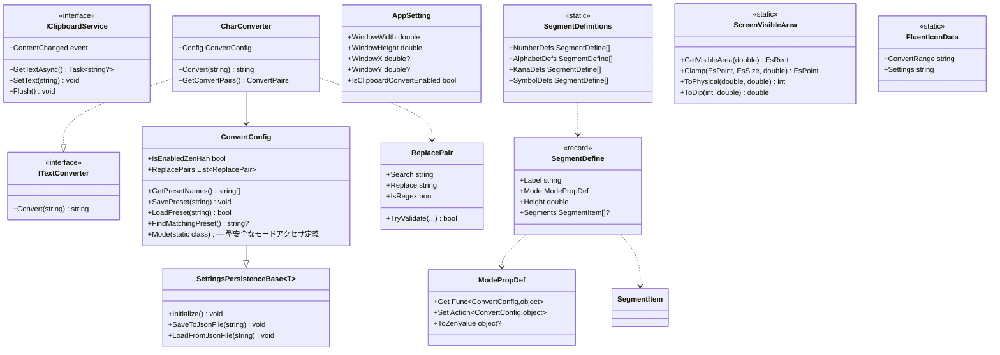
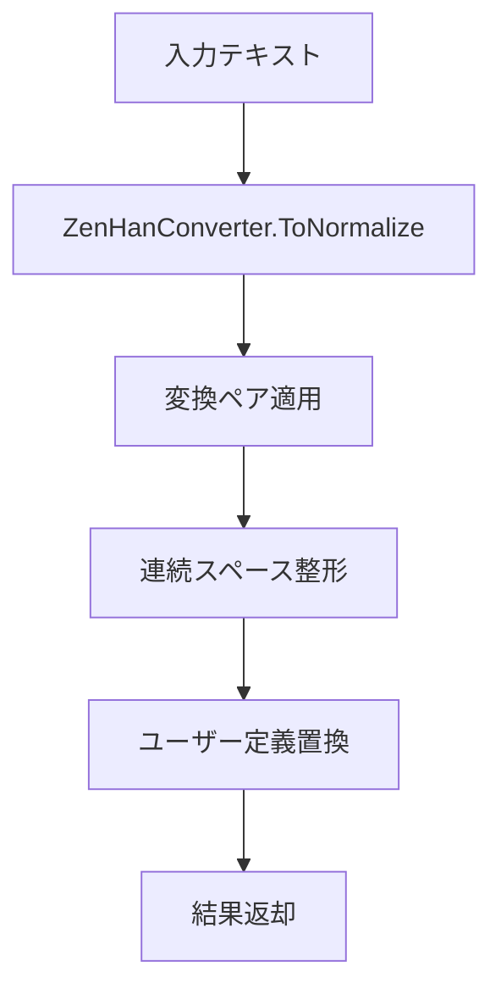

# ZenHanConverter.Core システム仕様書

本ドキュメントは `src/core` プロジェクトのシステム仕様（概要・アーキテクチャ・構成・変換フロー）を記載します。
メソッド内部のコードは記載しません。

## システム概要

`src/core` はクリップボードの全角/半角自動変換のコアロジック・データモデル・ウィンドウ復元の補正を提供するライブラリです。
**MewUI にも WinUI3 にも依存しない**ため、WinUI 3 版・MewUI 版の双方で共有できます。

## 技術スタック

- .NET 10
- CommunityToolkit.Mvvm 8.*
- EsUtil.Feature.ZenHan.Core（0.1.* のパッケージ参照。全角/半角変換ペア）
- EsUtil.Platform.Core（0.2.* のパッケージ参照。幾何型・DPI 換算・Win32 のクリップボード／仮想画面）
- Win32 API（P/Invoke は EsUtil.Platform.Core が単一所有。UI フレームワーク非依存）
- Fluent Icons の SVG アセット（埋め込みリソース。パスデータは UI フレームワーク非依存の文字列として提供）

## アーキテクチャ

```text
src/core
├── Enums/        変換モード列挙型（値オブジェクト）
├── Models/       データモデル（ConvertConfig ほか）と変換カテゴリ定義（SegmentDefinitions）
├── Interfaces/   抽象化（DIP 用）
├── Logic/        変換ロジック（CharConverter）と変更検出（ClipboardChangeDetector）
├── Helpers/      変換ペア解決拡張、ウィンドウ位置補正、上下分割比率
├── Native/       仮想画面と DIP ⇔ 物理ピクセルの換算（Win32 の呼び出しは EsUtil.Platform.Core）
└── Icons/        Fluent Icons の SVG アセットとパスデータ提供
```

依存方向は単一方向（Helpers → Enums/Models/EsUtil.Platform.Core、Logic → Enums/Models/Helpers/Interfaces、Native → EsUtil.Platform.Core、Icons → なし）です。
UI（`src/app_MewUI`）は `Interfaces` と `Logic`・`Models`・`Helpers`・`Native`・`Icons` を参照します（`INavigationService` は UI 要素を返すため App 層に配置）。

## クラス図



## 変換フロー



`CharConverter.Convert` の処理順序:

1. null / 空文字チェック
2. 全角/半角変換（常に実行）
3. ユーザー定義置換（常に適用）

変換を実行するか否かは呼び出し側（画面側）のポリシーです。`ConvertConfig.IsEnabledZenHan` は現在の両アプリ（MewUI 版・WinUI 3 版）とも参照せず、変換エンジンも参照しません。

## 設定の自動保存

`SettingsPersistenceBase<T>` がプロパティ変更を監視し、300ms のデバウンス後に JSON ファイルへ保存します。
保存先は `%LOCALAPPDATA%\ZenHanConverter\` 配下（`Settings.json` / `AppSetting.json`）。

## テスト

`test/core` 配下にソースファイル每の単体テストを置きます（xUnit v3）。
ファイルを書き込むテストでは、実ユーザーの設定ファイルを汚さないよう `AutoSaveFileName` を一時ディレクトリへ差し替えます。

| テスト | 対象 |
| --- | --- |
| `Logic/CharConverterTests` | 変換モード別の変換、置換ルール、ペアのキャッシュと破棄 |
| `Models/ConvertConfigTests` | 既定値、`Mode` アクセサ、プリセット、エクスポート/インポート |
| `Models/ReplacePairTests` | 検証ロジックと値の等価性 |
| `Models/SegmentItemTests` | `SegmentItem` / `SegmentDefine` の値の保持 |
| `Models/AppSettingTests` | 既定値と JSON からの復元 |
| `Models/SettingsPersistenceBaseTests` | JSON 入出力とリソース解放 |
| `Models/SegmentDefinitionsTests` | セグメント定義の項目・ラベル・モード接続 |
| `Helpers/ZenHanConverterExtensionTests` | モード別の変換ペア解決 |
| `Helpers/WindowPlacementTests` | 表示領域内への位置補正（純粋ロジック） |
| `Helpers/SplitLayoutTests` | 上下分割比率の換算と上下限の補正（純粋ロジック） |
| `Logic/ClipboardChangeDetectorTests` | シーケンス番号による変更検出 |
| `Icons/FluentIconDataTests` | SVG パスデータの抽出とキャッシュ |

クリップボードと仮想画面の Win32 実装（`EsUtil.Platform.Core`）は、EsUtil 側の `WinClipboardTests` が検証します。

## 依存関係

本プロジェクトが直接参照するプロジェクトとパッケージです（版は `Directory.Packages.props` が単一所有します）。

| 種別 | 参照先 | 用途 |
| --- | --- | --- |
| プロジェクト | `ZenHanConverter.Core` | 変換ロジック・設定モデル・Win32 連携 |
| プロジェクト | `ZenHanConverter.Presentation` | UI 非依存の ViewModel |
| パッケージ | `EsUtil.Feature.ZenHan.Core` | 変換ペア・記号表（変換の定義） |
| パッケージ | `EsUtil.Platform.Core` | 画面座標・ウィンドウ配置の共通実装 |
| パッケージ | `CommunityToolkit.Mvvm` | 変更通知とコマンド |
| パッケージ | `Microsoft.Extensions.Hosting` | DI コンテナ |
| パッケージ | `EsUtil.Ui.<UI>.*` | マーキー・ルーペ・列パッキングのコントロール（UI ごと） |

- 依存の版は `Directory.Packages.props` が単一所有し、復元は `packages.lock.json` で固定します（`.github/CONTRIBUTING.md`）。

## 例外処理ポリシー

- 設定ファイルの読み書き失敗（IOException / UnauthorizedAccessException / JsonException）は握り潰し、アプリ動作を継続。
- ユーザー定義の正規表現が不正な場合は該当ルールをスキップして処理継続。
